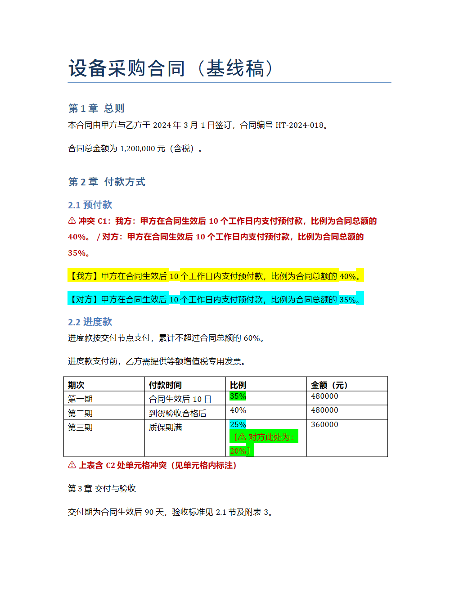
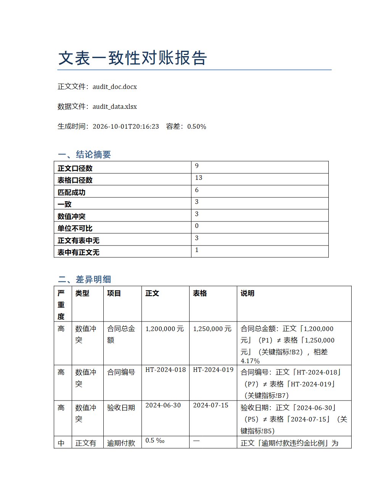
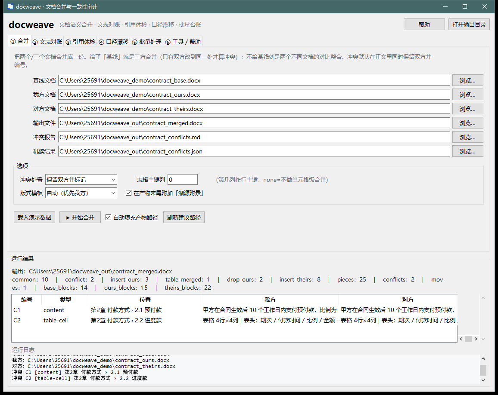

# docweave · 文档语义合并与一致性审计

> 批量处理 docx / xlsx / csv，把一个文档和另一个文档**比对并整合**，
> 并且解决一批「有需求但没有现成工具」的问题。

```
docweave merge  三方/两方语义合并  —— 共同基线、段落搬移检测、单元格级表格合并、逐块溯源
docweave audit  文表对账          —— 正文里的数字/日期/编号 与 表格数据 逐项核对
docweave refs   编号与引用体检     —— 悬空引用、编号断档、编号重复
docweave drift  口径漂移          —— 跨版本指标漂移 + 同一份文档自相矛盾
docweave batch  批量编排          —— 目录级批处理 + 增量台账 + HTML 汇总报告
docweave process-dir               —— 扫描目录、识别变化并增量处理
```



*（上图为三方合并结果的真实渲染：红色冲突提示 + 黄色我方内容 + 青色对方内容 + 绿色取自对方的单元格与标注）*

在线对账报告的效果：



---

## 一、为什么还需要一个文档工具

Word 自带「比较/合并」、Excel 自带「合并计算」、市面上也有一堆文件对比软件，所以本工具**刻意不做**这些大众功能，只做它们做不到或者做不好的事：

| 真实痛点 | 现有工具 | docweave |
| --- | --- | --- |
| 两份改稿各有改动，要合并成一份 | Word「合并」只能两两比较，没有共同基线，会把大量未改内容报成修改 | 三方合并（基线+我方+对方），只有**双方都改同一处**才算冲突 |
| 整段被搬到了别的位置 | Word 只报「删除 + 新增」，看不出是搬移 | 识别**段落搬移**（含「搬移并顺手改了内容」），并写入报告 |
| 表格里改了几个单元格 | Word 会把整张表报成一大段差异 | 表格做到**单元格级合并**，冲突定位到「第几行第几列的哪一格」 |
| 正文说金额 120 万，附表写 125 万 | 没有任何工具会去比对两个不同格式的文件 | **文表对账**：正文 ↔ xlsx/csv 的数字、日期、编号逐项核对，带单位换算与容差 |
| 合并后「见 3.2 节」指向了不存在的小节 | 没有人检查交叉引用 | **引用体检**：悬空引用 / 编号断档 / 编号重复 |
| 同一份文档里金额写了两个不同的数 | 无人检查 | **自相矛盾检测**（标签模糊匹配，能识别「再次确认：合同总金额为…」这类改写） |
| 每份文档的编号、图片、编号列表格式 | 合并后常丢格式 | 以原文档为版式模板，**移植样式、编号定义（numId 重映射）、图片与超链接关系** |
| 批量处理几百份文档，跑第二遍要重来 | 脚本自己写 | **增量台账**：按内容指纹跳过没变的，留痕可回溯 |

---

## 二、两种用法：图形界面 或 命令行

### 方式 A：直接双击 exe（推荐给不写命令的人）



`dist/docweave.exe` 是**单文件绿色程序（23.9 MB）**：不需要安装 Python、不需要装依赖、不写注册表，
双击即用，拷到任何 Windows 机器上都能跑。首次启动会因为自解压多等 2–5 秒属于正常。

六个页签对应五种能力加工具：

| 页签 | 做什么 |
| --- | --- |
| ① 合并 | 选「基线 / 我方 / 对方」（基线可留空）→ 选输出文件 → 开始合并；结果表列出每一处冲突的双方原文 |
| ② 文表对账 | 选正文 + 数据表 → 开始对账；结果表按严重度列出数值冲突、单位不可比、单侧缺失 |
| ③ 引用体检 | 选文档 → 开始体检；结果表列出悬空引用、编号重复、编号断档 |
| ④ 口径漂移 | 加入同一文档的多个版本（可加整个目录）→ 开始分析；结果表列出跨版本变化与自相矛盾 |
| ⑤ 批量处理 | 选目录 →「扫描并增量处理」；也可以先预览清单，再手动启动；结果与文件变化汇总成 HTML 报告 |
| ⑥ 工具/帮助 | 一键生成演示数据、查看/清除增量台账、Excel 公式重算，以及界面内的完整使用说明与图例 |

界面上的便利设计：每个页签都有「载入演示数据」按钮（自动生成样例并填好路径），
「自动填充产物路径」会按输入文件名推导输出名，结果区选中一行即可「打开选中的产物」，
所有耗时操作都在后台线程执行、不会卡界面，异常会显示在运行日志里而不是悄悄失败。

命令行参数（可配合快捷方式使用）：

```
docweave.exe                     正常启动图形界面
docweave.exe --demo-mode         启动并自动跑一遍演示
docweave.exe --selftest <目录>    无界面自检（跑通全部五种能力，写 _selftest.json）
docweave.exe --uitest   <目录>    界面级自检（自动驱动六个页签并校验结果回填）
docweave.exe --version           显示版本
```

自己重新打包（源码改动后）：

```powershell
& $py tools\build_exe.py          # 生成图标 → PyInstaller 打包 → 用 exe 自检
```

### 方式 B：命令行

命令行与图形界面共用同一套引擎，适合接进自动化流水线。
无需安装依赖（使用运行时自带的 python-docx / openpyxl / lxml）。

```powershell
$py = "<Python 可执行文件>"

# 1) 一键演示：自动生成样例 → 自动生成清单 → 批量处理 → 出 HTML 报告
& $py -m docweave demo

# 2) 三方合并（有共同基线）
& $py -m docweave merge 基线.docx 我方.docx 对方.docx -o 合并.docx --report 冲突.md

# 3) 两个不同文档的对比 + 整合（没有基线也行）
& $py -m docweave merge A.docx B.docx -o 整合.docx

# 4) 文表对账（正文 ↔ 数据表），输出一份把两边整合在一起的 Word 报告
& $py -m docweave audit 合同.docx 指标表.xlsx -o 对账报告.docx --report 对账.md

# 5) 引用体检 / 口径漂移
& $py -m docweave refs 方案.docx -o 引用体检.docx
& $py -m docweave drift spec_v1.docx spec_v2.docx spec_v3.docx -o 漂移报告.docx

# 6) 扫描一个目录，自动生成批量清单并运行
& $py -m docweave plan .\合同资料 -o manifest.json
& $py -m docweave batch manifest.json
```

支持格式：**输入** `.docx / .xlsx / .xlsm / .csv / .tsv / .md / .txt`；**输出** `.docx`（正文类）或 `.xlsx`（表格类）。
旧版二进制格式 `.doc / .xls` 会给出明确提示，要求先另存为新格式（不做静默重命名）。

---

## 三、五个能力详解

### 1. `merge` —— 语义合并

```powershell
docweave merge [基线] 我方 对方 -o 输出.docx [--report r.md] [--json s.json]
               [--on-conflict mark|ours|theirs] [--table-key 0|none]
               [--template ours|base|theirs] [--no-appendix]
```

* **三方合并**：给基线 → 只有双方改到同一处才冲突；单侧修改自动采用；单侧删除生效。
* **两方整合**：不给基线 → 相同内容合并、仅一方有的内容全部保留、同位置不同内容标记为差异。
* **冲突处置**：默认 `mark`（正文里同时保留双方，黄色=我方、青色=对方，并编号 C1/C2…）；
  也可以 `--on-conflict ours|theirs` 直接定稿（冲突仍记入报告，不会悄悄丢数据）。
* **表格**：`--table-key` 指定用第几列作行主键（默认第 1 列）。行在 → 逐单元格合并；
  行只在对方 → 追加；行被删除 → 删除生效并写行进记录。整表冲突时保留双方并告警。
* **溯源附录**：文末自动附加「冲突清单 / 表格行级处理记录 / 段落搬移记录 / 逐块来源表」，
  每个块都能查到它来自哪个文件的哪个位置（标题路径 + 段落号）。
* **机读 sidecar**：`--json` 输出冲突、搬移、逐块来源，方便接进自己的流水线。

输出的颜色图例：**黄色 = 我方内容，青色 = 对方内容，绿色 = 取自对方的表格单元格/标注**。

**输出规范**：报告、附录与界面里的「类型 / 动作 / 冲突类型 / 问题类型」列一律是中文
（标题·段落·列表·图片·表格；内容分歧·表格单元格；数值冲突·悬空引用…），
内部代号只出现在 `--json` 的机读文件里。Markdown 与 HTML 报告写成 **UTF-8 带 BOM + CRLF**，
在中文 Windows 上用记事本直接打开也不会乱码（JSON 保持标准 UTF-8 不带 BOM）。
生成的 Word/Excel 产物里所有 `w:rPr` 子元素都按 OOXML 规定次序插入，避免 Word/WPS 提示"修复"；
示意图类图片用系统中文字体（微软雅黑/黑体/宋体）绘制，不会出现 ▯▯▯ 方块。

### 2. `audit` —— 文表对账（跨格式一致性）

```powershell
docweave audit 正文.docx 数据.xlsx -o 对账报告.docx [--report r.md] [--json s.json]
               [--tol 0.005] [--show-ok] [--no-embed] [--recalc]
```

从正文中抽取「指标名 + 取值 + 单位」，从表格中抽取「行标签 + 列标题 + 单位列 + 取值」，然后按标签相似度配对核对：

* 判定类型：`数值冲突`（高）、`单位不可比`（中）、`正文有表中无`（中）、`表中有正文无`（低）、`一致`。
* **单位换算**：元/千元/万/万元/亿元、%/‰/个百分点、天/日/个月/月/年（30/365 天折算）、件/台/期等。
* **类型识别**：金额、百分比、工期、数量、日期（`2024年6月30日` ↔ `2024-06-30`）、编号（`HT-2024-018`）、
  标准号（`GB 50174` 识别为编号而不是数字 50174）；独立的 `2025 年` 识别为日期而不是工期。
* **区间不误判**：`18—27℃`、`35%—65%`、`3.5kW~8kW` 整体记作一条区间口径，不参与比大小，避免被拆成两个数后误报"自相矛盾"。
* **中文表格适配**：首列是「序号」时自动改用第二列作行标签；同一行有多个数字列（现状/目标、预算/实际）时用列标题消歧；
  单位写在表头里（`金额（万元）`）也能取到，不要求一定有独立的「单位」列。
* **百分比自适应**：`0.3` + `0%` 格式、`0.3` + 单位列 `%`、`30%` 文本，都能对齐到同一个 30%。
* **抗误报**：标签匹配要求「短标签的字符几乎都出现在长标签里」，
  所以「逾期付款违约金比例」不会被误配到「预付款比例」；配对失败时会在说明里给出「表中最接近的项」。
* **噪声控制**：只有覆盖率够高的工作表才会报「表中有正文无」；
  「正文有表中无」最多列 12 条，其余折叠成一句提示（完整清单在报告的附录里），避免把真冲突淹没。
* `--recalc`：先用内置 LibreOffice 重算 xlsx 公式缓存再对账（Excel 里的公式结果可能是过期缓存）。
* 输出的 docx 报告会把**正文口径清单 + 数据表口径清单 + 数据表原文**整合进同一份文档。

### 3. `refs` —— 编号与交叉引用体检

```powershell
docweave refs 方案.docx -o 体检报告.docx [--report r.md] [--json s.json]
```

* **悬空引用**：`第3章`、`3.2 节`、`图 3`、`表 2`、`附件 5`、`第X条` 指向了不存在的目标（高）。
* **编号重复**：同一编号出现多次（高）。
* **编号断档**：图 1、图 3 → 缺 图 2；第1章、第2章、第4章 → 缺 第3章；`3.1`、`3.3` → 缺 `3.2`。
* **模糊引用**：`见上文`、`如前所述` 这类无法机器校验的引用。
* 报告附「编号台账」，列出每个编号出现在哪些位置。
* 不会把标题/题注自己的编号误判成引用（`第2章 系统架构` 不算引用）。

### 4. `drift` —— 口径漂移与自相矛盾

```powershell
docweave drift v1.docx v2.docx v3.docx -o 漂移.docx     # 也可以直接给一个目录
```

* **文档内自相矛盾**（最高优先级）：同一份文档里，同一个指标出现两个不同取值。
  使用标签模糊匹配，因此「合同总金额为 1,250,000 元」和「再次确认：合同总金额为 1,300,000 元」能被识别为同一指标。
* **跨版本漂移**：同一指标在各版本之间的取值序列与变化方向。
* 只给一个文件时，就只做自相矛盾检查。

### 5. `batch` —— 批量处理 + 增量台账

```powershell
docweave batch manifest.json [--outdir DIR] [--force] [--ledger-root DIR] [--quiet]
docweave process-dir <目录> [--outdir DIR] [--force] [--quiet]
docweave ledger --root demo/out [--reset]
```

* 清单里可以写单文件任务，也可以写**目录型任务**：`merge-dir`、`refs-dir`、`drift-dir`。
* **增量台账** `.docweave/ledger.json`：按输入文件的 sha256 指纹判断是否真的变了，
  没变就直接跳过（时间戳变化不会触发重跑）；保留最近 500 条运行历史。
* 汇总产出 `batch_report.html`（自带样式，含任务概览、问题明细、图例）和 `batch_summary.json`。
* `docweave plan <目录>` 会扫描目录自动发现 `*_base/_ours/_theirs` 组合、`正文+数据表` 配对、
  版本序列（`*_v1/_v2/...`），生成清单后再 `batch` 即可。
* `process-dir` 与 GUI 的「扫描并增量处理」一次完成目录快照、任务识别和批处理：
  变化文件记录在 `.docweave/scan_log.jsonl`，未变化任务由内容指纹台账跳过，
  文件变化与处理结果一并写入 HTML/JSON 报告。默认扫描目录第一层，与自动规划范围一致。
* 也可分步运行 `plan` + `batch`，用于检查或手工编辑任务清单。

清单示例：

```json
{
  "options": { "tol": 0.005, "outdir": "out" },
  "jobs": [
    { "type": "merge", "base": "合同_base.docx", "ours": "合同_ours.docx",
      "theirs": "合同_theirs.docx", "out": "out/合同_merged.docx",
      "on_conflict": "mark", "report": "out/合同_冲突.md", "sidecars": "out/合同_冲突.json",
      "appendix": true },
    { "type": "merge-dir", "dir": "in", "suffixes": {"base": "_base", "ours": "_ours", "theirs": "_theirs"},
      "outdir": "out/merged" },
    { "type": "audit", "doc": "合同.docx", "data": "指标表.xlsx",
      "out": "out/对账.docx", "tol": 0.005, "recalc": true },
    { "type": "refs-dir", "dir": "in", "outdir": "out/refs" },
    { "type": "drift", "files": ["v1.docx", "v2.docx", "v3.docx"], "out": "out/漂移.docx" }
  ]
}
```

---

## 四、工作原理（要点）

1. **统一文档模型**：docx 的段落/标题/表格、xlsx 的工作表、csv、md 都归一成 `Block` 序列；
   每个 Block 保留原文（用于输出）、归一化文本（全角→半角、去空白、标点统一，用于对齐）、
   标题路径与定位符；docx 的 Block 还保留原始 OOXML 元素。
2. **两级对齐**：先用「两侧都唯一出现的完全相同文本」作锚点（避免重复内容带偏），
   锚点之间的区域再用相似度 DP 对齐（相似度 = 字符级 ratio，数字不同轻微降权，表格按行键 + 单元格）。
   超大区域退化到贪心对齐，保证性能。
3. **移动检测**：某侧「新增」的内容与同侧「删除」的内容完全一致 → 搬移；
   相似度 ≥ 0.9 → 「搬移并修改」。
4. **三方合并**：把两侧各自的「基线→该侧」映射叠起来，逐块判定；
   双方都改同一处且结果不同 → 冲突并编号。
5. **写回时保真**：以原始文档为版式模板，逐块深拷贝 OOXML；
   跨文档移植**样式**、**编号定义**（创建缺失的 numbering 部件并重映射 `numId`）、
   **图片与超链接关系**（重新建立 relationship，图片走 `get_or_add_image`）。
   实测：对方文档里的图片、编号列表、自定义样式都能原样出现在合并结果中。
6. **报告可回溯**：每一个输出块都有「动作 + 来源 + 定位 + 摘要」，冲突有编号，可与 sidecar JSON 对照。

---

## 五、已知边界（如实说明）

* **格式范围**：只处理 OOXML；`.doc/.xls` 二进制旧格式需先另存。不处理 PDF、加密文档、宏逻辑。
* **修订痕迹**：输入含未接受的修订时，处理的是「当前显示内容」，工具会在报告里给出告警，建议先接受/拒绝修订。
* **纯格式改动**：只改字号/颜色而文字不变时，视为「无改动」——合并以文本与结构为准，不比对格式差异。
* **两方模式的价值取向**：没有基线时无法判断谁对，默认**保留 A 的内容 + 标注 B 的取值**（可用 `--on-conflict theirs` 反转）；
  想真正合并改稿，请提供共同基线走三方合并。
  一侧把整章挪了位置时会做**搬移消重**：同一章只出现一次，搬移章节里被改过的内容会变成冲突而不是被丢掉。
* **表格合并**：需要两侧列数一致且不含合并单元格（`gridSpan/vMerge`）才做单元格级合并，否则整表标为结构冲突并保留双方。
* **xlsx 公式**：默认读取的是**缓存值**（可能过期），公式字符串会随合并结果一并保留；
  需要最新数值请用 `--recalc`（调用内置 LibreOffice 重算）。
* 段落内的字段（如自动目录、交叉引用域）按显示文本处理，不会重算域。
* **图形界面/exe 相关**：exe 首次启动要自解压，多等 2–5 秒属正常；「重算公式」按钮依赖内置
  LibreOffice 套件（可用环境变量 `DSH_LO_NODE` / `DSH_LO_CLI` 指定），找不到会给出明确报错；
  「载入演示数据」会把样例写到 `%USERPROFILE%\docweave_demo`，产物默认写到 `%USERPROFILE%\docweave_out`。

---

## 六、目录结构与验证

```
docweave/
  model.py    统一文档模型与读取器（docx/xlsx/csv/md/txt、归一化、相似度）
  merge.py    对齐、移动检测、两方/三方合并、单元格级表格合并
  writers.py  docx/xlsx 写出器（样式/编号/关系移植、冲突标记、溯源附录、Markdown 报告）
  audit.py    口径抽取与对账、引用体检、口径漂移、三类 docx 报告
  ops.py      批量编排、增量台账、HTML 报告、LibreOffice 公式重算、清单自动发现
  samples.py  演示样例生成器（GUI 与 demo 脚本共用）
  gui.py      图形界面（tkinter；也是 exe 的入口，含 --selftest / --uitest / --demo-mode）
  cli.py      命令行
tools/
  build_exe.py  PyInstaller 打包脚本（自动生成图标、打包后自动用 exe 自检）
  gui_shot.py   给 GUI 窗口截图（验证界面真的画出来了）
  exe_entry.py  打包入口
demo/
  make_fixtures.py  生成演示样例（三方合同稿、文表对账、引用体检、版本漂移、表格合并）
  assets/           图标与界面截图
  fixtures/         样例文档
  out/              运行产物（合并结果、报告、HTML、台账、渲染预览）
dist/
  docweave.exe      单文件图形界面程序（23.9 MB，免安装）
tests/
  run_tests.py      端到端自检（89 项断言）
```

```powershell
& $py tests\run_tests.py        # 全绿：通过 89 项，失败 0 项
& $py -m docweave demo          # 一键跑通演示（命令行）
& $py demo\make_work_docs.py    # 生成两份有差异的工作文档到桌面，用来手工试用
& $py tools\build_exe.py        # 打包 exe，并用 exe 自己做无界面自检
```

自检覆盖：文档模型与读取、两级对齐、搬移检测、三方/两方合并、单元格级表格合并与冲突定位、
docx 写出的冲突高亮/溯源附录/`sectPr` 位置/编号定义可用性/图片关系可解析、
xlsx 写出的值/公式存活/冲突着色/报告页、对账的 3 处冲突与 3 处一致、
引用体检的 5 处悬空引用 + 1 处重复 + 2 处断档、漂移的 4 项变化 + 1 处自相矛盾、
批量增量台账（首跑成功 / 二次跳过 / `--force` 重跑）、csv 合并路径。

exe 的两级自检（都在**脱离源码目录**、从 `%TEMP%` 启动的情况下跑通）：

* `docweave.exe --selftest <目录>` → 退出码 0，五项检查：合并冲突 2、对账数值冲突 3、
  悬空引用 5、文档内自相矛盾 1、批量成功 12；产物与 HTML 报告齐全。
  这同时证明了 python-docx 模板、openpyxl、lxml、Pillow 都被正确打进单文件里。
* `docweave.exe --uitest <目录>` → 退出码 0，七个界面检查全部自动跑通：
  合并 2 行冲突、对账 7 条、对账勾选框联动（7 → 10 条）、体检 8 条、漂移 5 条、
  批量 5 任务/12 条、台账 12 条。

产物另外通过了 Office 结构校验（ZIP/XML 完整性、关系、段落与表格维度），
并用内置 LibreOffice 渲染成图片做了版面确认（见上方示例图与 `demo/assets/`）。
